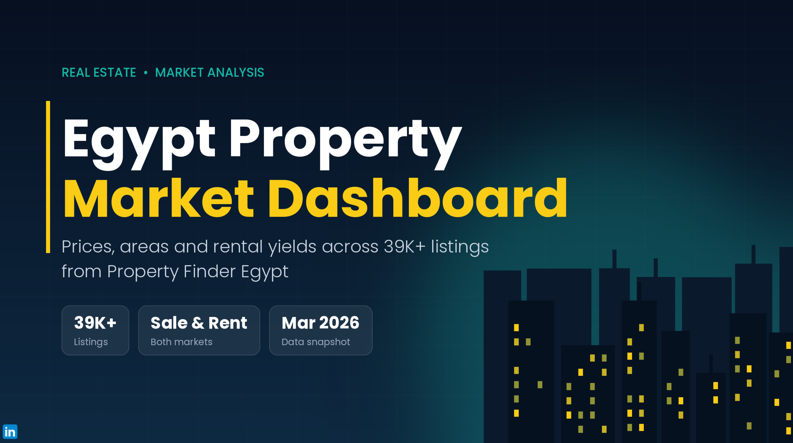

# 🏢 Egypt Property Market Analytics Dashboard

An end-to-end interactive Power BI dashboard analyzing **39.6K+ Property Finder Egypt listings** (March 2026 data snapshot) to evaluate pricing, rental yields, room configurations, and market supply dynamics across Egypt.

---

## 🚀 Live Interactive Deployment & Artifacts
* 🌐 **Power BI Service:** Published to Power BI Cloud for interactive web consumption and cross-device responsiveness.
* 📹 **Watch Interactive Video:** [Click here to watch the full interactive walkthrough](Project-%20Video%20Interactive.mp4)
* 📄 **Download Documentation:** [View Project PDF Report](Project%20PDF.pdf)

---

## 🧹 Data Profiling, Cleaning & Transformation (ETL)
Prior to building the analytical data model, deep data profiling and data cleaning were executed using **Power Query (M)** and **DAX** to ensure 100% data integrity:

1. **Header & Structure Alignment:** Promoted the first row as headers (`Promoted Headers`) to correctly structure raw dataset attributes.
2. **Data Type Enforcement:** Corrected implicit data types across multiple attributes, converting numbers stored as text into proper numeric data types for accurate aggregation.
3. **Deep Data Profiling:** Enabled **Column Quality**, **Column Profile**, and **Column Distribution** views set to inspect the entire dataset (*Based on all rows*) rather than default previews, allowing exact error and null detection.
4. **Mislabeled Category Logic (Hybrid Power Query + DAX Solution):**
   * Identified listings categorized under 'Rent' while their actual ad titles specified 'Sale' (Buy).
   * To preserve valuable listing records without dropping rows, created a clean classification column using conditional logic and **DAX** to systematically reclassify mislabeled properties based on title text matching.
5. **Standardization & Outlier Filtering:** Filtered extreme price/m² outliers and standardized location hierarchies (Towns, Cities, Districts) for seamless drill-down analysis.

---

## 🎨 Dashboard Design & Architecture

### 1. Interactive Landing Page (Cover)
* **Visual Engagement:** Designed a dynamic cover page that instantly grabs the user's attention while providing an executive project summary.
* **4 Core Pillars:** Structured the report into 4 focused navigation pages accessible via a custom navigation bar.

---

## 📊 Core Analytical Pillars

### 📍 Pillar 1: Market Overview
* **Interactive Filtering:** Integrated dynamic top-level slicers (Property Type, Buy/Rent categories) for seamless filtering.
* **Executive Fact Cards:** Placed 3 KPI cards highlighting foundational metrics (Total Listings: 39.6K, Median Sale Price/m², Median Monthly Rent).
* **Market Insights:** Analyzed listing distribution (~50/50 Sale vs. Rent), top 5 cities (New Cairo, Sheikh Zayed, 6th of October, Hurghada, Madinaty), payment methods, and completion status.

### 💰 Pillar 2: Price Analysis
* **Dynamic Chart Switcher:** Implemented a field parameter toggle button to switch between charts and maximize visual space.
* **Square Meter Pricing:** Evaluated **Median Price / m²** across locations (Town, City, District).
* **Property Ranking:** Ranked property types by unit economics (Hotel Apartments, Villas, Chalets, Apartments).

### 🏠 Pillar 3: Rental Insights
* **Dedicated Rental Analytics:** Evaluated long-term and short-term rental performance across regions.
* **Rental Rate Benchmarking:** Tracked **Median Price / m²** for rentals in premium areas (Zamalek, New Cairo, Mokattam).
* **Price Tier Breakdown:** Categorized listings into customizable price bins ($0–15K, $15K–70K, $70K–140K, >$200K).

### 📦 Pillar 4: Market Supply & Inventory
* **Supply Composition:** Visualized available inventory distribution across key cities segmented by property category.
* **Time Trends:** Tracked total supply trends hierarchically across Year, Quarter, Month, and Day.
* **Size Distribution:** Analyzed inventory dominance by room configurations (3-bedroom and 2-bedroom units).

---

## 🛠️ Tech Stack & Methodology
* **Visualization & Service:** Power BI Desktop, Power BI Service (Cloud Publishing)
* **ETL & Data Profiling:** Power Query (M Language - Column Quality, Promoted Headers, Type Conversion)
* **Data Modeling:** Snowflake Schema architecture
* **Advanced Analytics:** DAX (Conditional Logic Columns, Dynamic Measures, Field Parameters, Custom Ranking)
